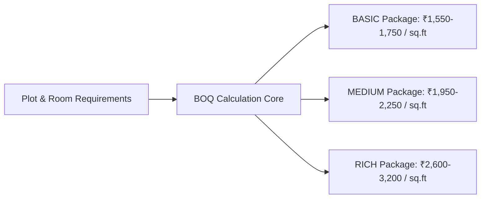

# Bill of Quantities (BOQ) & Cost Estimation Standards

## Engineering Principles & Calculation Framework
The estimation module computes transparent, itemized material quantities and labour costs derived from structural engineering rules of thumb and Indian Standard (IS) codes (IS 1200 series for building measurements).

---

## Regional Baseline Rates (Warangal / Telangana Region)
Rates are parameterized and stored in `backend/src/data/defaultRates.json` and are editable by administrators.

| Category | Material Specification | Typical Unit | Material Rate (INR) | Labour Rate (INR) | Wastage Allowance (%) |
|---|---|---|---|---|---|
| **Cement** | OPC 53 / PPC Grade 50kg bag | bag | ₹380 / bag | ₹35 / bag handling | 2.5% |
| **Steel (TMT)** | Fe 550D TMT Reinforcement Bars | kg | ₹68 / kg | ₹9 / kg cutting/bending | 4.0% |
| **Fine Sand** | River Sand / Robosand (M-Sand) | cft | ₹55 / cft | Included in masonry | 5.0% |
| **Coarse Aggregate** | 20mm & 10mm crushed granite | cft | ₹42 / cft | Included in concrete | 3.0% |
| **Clay Bricks** | Standard 9" x 4" x 3" Red Clay | 1000 nos | ₹8,500 / 1k | ₹3,200 / 1k laying | 5.0% |
| **AAC Blocks** | 600 x 200 x 150mm lightweight blocks | cft | ₹72 / cft | ₹22 / cft laying | 3.0% |
| **Vitrified Tiles** | 2' x 2' or 4' x 2' Double Charged | sq.ft | ₹58 / sq.ft | ₹22 / sq.ft fixing | 7.0% |
| **Granite Counter** | Black Galaxy 18mm polished | sq.ft | ₹180 / sq.ft | ₹45 / sq.ft moulding | 5.0% |
| **Interior Paint** | Royal Luxury Emulsion (2 coats + putty) | sq.ft | ₹18 / sq.ft | ₹14 / sq.ft application | 3.0% |
| **Plumbing** | CPVC/UPVC pipes, sanitary fixtures | lump sum | Calculated per bath | Per fixture rate | 3.0% |
| **Electrical** | FRLS copper wires, modular switches | point | ₹650 / point | ₹250 / point | 2.0% |

---

## Mathematical Formulation

### 1. Built-Up Area ($A_{\text{built}}$)
$$A_{\text{built}} = \sum_{f=1}^{N_{\text{floors}}} A_{\text{floor}, f}$$

### 2. Concrete Volume ($V_{\text{concrete}}$)
$$V_{\text{concrete}} \approx A_{\text{built}} \times 0.13 \text{ m}^3/\text{m}^2 \approx A_{\text{built}} \times 0.039 \text{ m}^3/\text{sq.ft}$$

### 3. Steel Quantity ($Q_{\text{steel}}$)
$$Q_{\text{steel}} \approx A_{\text{built}} \times 3.8 \text{ kg/sq.ft}$$

### 4. Cement Bags ($Q_{\text{cement}}$)
$$Q_{\text{cement}} \approx A_{\text{built}} \times 0.42 \text{ bags/sq.ft}$$

### 5. Tiles Estimation
$$\text{Purchasable Tile Area} = (\text{Room Floor Area} - \text{Excluded Area}) \times (1 + \text{Wastage Allowance})$$
$$\text{Cost}_{\text{tiles}} = (\text{Purchasable Area} \times \text{Material Rate}) + (\text{Room Floor Area} \times \text{Labour Rate})$$

---

## 3-Tier Package Architecture

1. **Basic Tier**:
   - Red Clay / Fly Ash bricks, Vitrified 2x2 standard tiles, Anchor Roma switches, Asian Paints Tractor emulsion, flush doors, aluminum 2-track windows.
2. **Medium Tier**:
   - AAC blocks / Wire-cut bricks, 4x2 GVT glazed vitrified tiles, Legrand switches, Asian Paints Apcolite Premium, Teak wood main door & flush internal, UPVC 3-track sliding windows with mosquito mesh, modular kitchen under-counter storage.
3. **Rich / Luxury Tier**:
   - Italian marble / large format 6x4 slab tiles, Schneider smart modular automation switches, Asian Paints Royale Aspira / PU finish, solid Teak carved entrance + veneer internal doors, Fenesta sound-proof UPVC / thermal break aluminum windows, full acrylic modular kitchen with quartz counter, walk-in designer wardrobes, false ceiling with cove lighting in all rooms.
