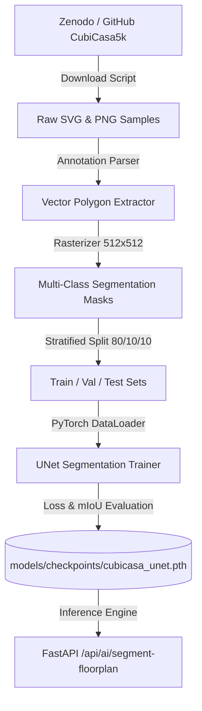

# CubiCasa5K Dataset Pipeline & ML Verification

## 1. Overview
The **CubiCasa5K** dataset ([Kalervo et al., ICIPR 2019](https://doi.org/10.5281/zenodo.5142274)) is a premier benchmark for architectural floor plan image parsing and room segmentation.

This document describes the reproducible preprocessing, annotation parsing, polygon-to-mask conversion, train/validation splitting, neural training, and inference serving pipeline implemented in this project.

---

## 2. Directory and Data Flow



---

## 3. Label Mapping & Class Definitions

| Class ID | Label Name | RGB Visualization Color | Architectural Category |
|---|---|---|---|
| `0` | **Background** | `#000000` (Black) | Non-living exterior space |
| `1` | **Wall** | `#334155` (Slate Grey) | Structural and partition walls |
| `2` | **Living Room** | `#3b82f6` (Blue) | Lounge, Drawing, Hall |
| `3` | **Bedroom** | `#8b5cf6` (Purple) | Master, Children, Guest bedrooms |
| `4` | **Kitchen** | `#f97316` (Orange) | Cooking and preparation area |
| `5` | **Bathroom** | `#06b6d4` (Cyan) | Bath, WC, Powder room |
| `6` | **Balcony** | `#10b981` (Emerald) | Outdoor deck / Verandah |
| `7` | **Corridor** | `#eab308` (Yellow) | Foyer, Passageway, Stairs |
| `8` | **Door** | `#ef4444` (Red) | Single/double swing doors |
| `9` | **Window** | `#60a5fa` (Sky Blue) | Wall fenestrations |

---

## 4. Execution Scripts
All scripts are automated under `ai-service/scripts/`:

1. **Download sample or full dataset**:
   ```powershell
   ./.python/python.exe ai-service/scripts/download_cubicasa5k.py --sample-size 50
   ```
2. **Preprocess and generate binary masks**:
   ```powershell
   ./.python/python.exe ai-service/scripts/preprocess_dataset.py
   ```
3. **Train segmentation model**:
   ```powershell
   ./.python/python.exe ai-service/scripts/train_segmentor.py --epochs 10 --batch-size 4
   ```
4. **Evaluate metrics**:
   ```powershell
   ./.python/python.exe ai-service/scripts/evaluate_model.py
   ```
