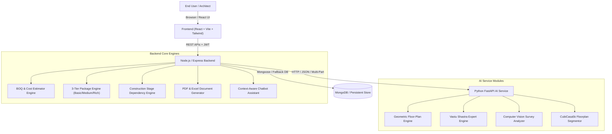

# System Architecture

## Project Overview
The **Intelligent House Design and Construction Assistant** is an end-to-end full-stack AI/ML platform tailored for residential architectural planning, geometric floor-plan generation, interior/exterior design specification, transparent BOQ (Bill of Quantities) estimation, Vastu compliance evaluation, construction milestone tracking, and project expense management.

---

## Architectural Diagram

---

## Component Details

### 1. Frontend (Client Tier)
- **Framework**: React 18+ with Vite for lightning-fast HMR and bundling.
- **Styling**: Modern architectural aesthetic with Vanilla CSS / Tailwind CSS design system tokens.
- **Key Modules**:
  - 6-Step Multi-Step Project Wizard with reactive validation and live plot shape calculation.
  - Interactive SVG Floor Plan Studio with pan/zoom, layer controls (doors, windows, furniture, dimensions, north arrow), and multi-floor switching.
  - 3-Tier Package Comparison Matrix (Basic, Medium, Rich) with detailed spec breakdown and budget deviation metrics.
  - Room-Wise Interior and Exterior Design Studio with materials, color palettes, and fixture specifications.
  - Vastu Compass & Orientation Inspector with zone-level compliance scoring.
  - Interactive Construction Progress Tracker with milestone dependency engine and eligible task detection.
  - Project Expense Tracker with invoice uploads, category-wise expenditure, and overrun alerts.
  - Context-Aware AI Chatbot Assistant for conversational house planning queries.
  - Survey Image Analyzer with boundary line visualization and aspect ratio checks.

### 2. Backend (Application Tier)
- **Runtime**: Node.js & Express.js.
- **Database**: MongoDB Atlas / Mongoose with a persistent fallback persistence adapter for resilient offline development.
- **Security**: JWT authentication, bcrypt password hashing, role-based access control (User vs Administrator), and resource ownership verification.
- **Engines**:
  - **BOQ Engine**: Computes exact material quantities, unit rates, wastage allowances, and labour expenses across 28 construction categories.
  - **Package Engine**: Normalizes specs into Basic, Medium, and Rich tiers without arbitrary multipliers.
  - **Dependency Engine**: Topological sort and status management for construction stages (Planning -> Foundation -> Frame -> Masonry -> Services -> Finishing -> Handover).
  - **Document Exporter**: Programmatically compiles project overview, architectural plans, BOQ, and timelines into PDF and Excel formats.

### 3. AI Service (Intelligence Tier)
- **Framework**: Python 3.11 with FastAPI.
- **Geometric Engine**: Non-overlapping polygon allocation and multi-floor circulation solver.
- **Vastu Evaluator**: Mathematical coordinate mapping to the 8 cardinal and inter-cardinal Vastu padas.
- **Computer Vision Module**: Edge detection, contour analysis, and perspective assessment for uploaded site drawings.
- **Machine Learning**: CubiCasa5K floor-plan segmentation models with evaluation metrics (mIoU).
